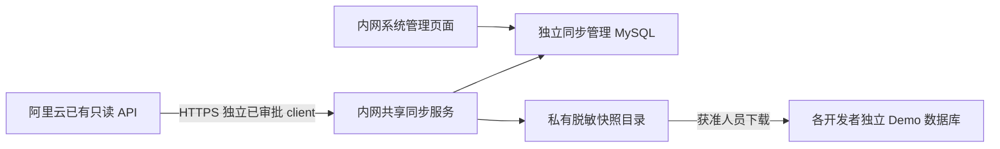

# 开发环境数据同步：首期快照闭环

开发基线：阿里云 V2.44.278，`b84040488e3391996142103fb9df76c08f5d7113`。
菜单：**系统管理 → 开发环境数据同步**；路由 `/system/demo-data-sync`。

## 部署职责



本功能页面与 worker 运行在同一个内网管理实例，使用独立的 `saas_collab_sync_` MySQL；worker 不直连生产数据库。阿里云继续使用原“API 数据接入 → 内部系统数据接口”审批开发专用调用方。生产默认关闭本功能。首期没有跨实例远程调度协议，不能在阿里云创建任务、再要求一个使用不同数据库的内网 worker 自动看到它。

支持商品、SKU、订单与订单明细、库存快照及必要平台、国家、店铺、仓库、分类依赖。财务、广告、采购、退款的接入与可靠变更增量属于后续阶段。

## 数据与授权合同

- 环境由具备 manage 权限的人员配置，指定本租户有效内部负责人、模块和店铺/仓库 ID；查询与下载强制租户和负责人隔离，manage 可管理本租户各环境。
- 独立权限：`system.demo_sync.view/manage/run/download`；新菜单 `menu.system.demo_data_sync.view`。新增迁移登记操作权限，不直接为普通角色授予。项目既有 `sync_permissions` 会将新增目录赋给租户 administrator，部署前需审核此标准行为。
- 页面选择销售会自动补齐明细、商品与主数据。独立选择商品/平台等主数据意味着选择该 client 授权租户内该块的完整主数据；它们没有店铺外键，店铺筛选不等于商品的强制店铺授权。调用方必须具备所有依赖块的读取权限，否则任务失败。
- 四域请求按每个店铺/仓库和日期分页；旧主数据仅使用分页。默认每页最多 100、单并发、成功页间隔 1 秒、单连接/读取超时 5/20 秒，429 和指定 5xx/连接超时最多 3 次尝试；401/403 不重试，拒绝重定向及环境代理。
- 快照为采集窗口数据，manifest 明确 `consistent=false`，不是跨表事务快照。窗口最多 31 天；重试创建新批次从第一页重扫，不将 ID 游标当变更水位。
- 白名单字段输出；身份/商业名称采用 HMAC 别名，图片 URL 与未列字段不落包，金额和时间保留用于验证。**脱敏包仍包含受控经营金额、数量及关系，须按授权和保留周期管理。** 盐只存在内网服务环境变量，不能分发给开发者。
- SHA256/计数与关联校验通过后才发布；日期、币种、金额精度沿用源合同。库存 `provided_quantity_fields` 保留，缺采字段不认定为真实零。
- 本地一次初始化：相同包重放无操作，保留用户测试修改；新包要求新工作库，不覆盖旧工作库。首次导入事务失败全部回滚。`SnapshotIdentity` 记录源/目标键，receipt 固定首次导入包。
- 环境停用会终止 queued 任务并阻断下载；running 每页重新检查环境及发起人权限，末次发布再次检查。超过 10 分钟无心跳可重新排队；旧任务失去运行状态后不能继续发布。

## 内网共享服务配置与执行

参考 `env.example`，秘密用组织既有凭据分发方式注入，不提交 `.env`。内网实例需要自己的 Django 签名密钥、MySQL 用户、证书和前端 API 地址，禁止复制生产应用配置或 Redis。

```powershell
$env:DJANGO_SETTINGS_MODULE = 'config.settings.demo_sync_service'
python manage.py migrate
python manage.py sync_permissions
python manage.py check
# 前端使用该内网实例的 API；在系统管理页面配置环境并提交任务。
python manage.py run_demo_snapshot --batch-id <页面上的批次UUID>
```

这些命令仅在新建内网管理实例执行。首期手动执行一个批次，没有新增 Celery/beat 自动调度。工作进程以只读源凭据发 HTTPS GET，将结果写入自己的私有目录与管理库。操作系统只允许管理进程读取目录；目录不得挂到 MEDIA/静态目录或共享公网文件服务。

部署需开启 `DEMO_DATA_SYNC_ENABLED` 与 `DEMO_DATA_SYNC_WORKER_ENABLED`；生产默认均 false。`demo_sync_service` 强制独立管理库前缀、禁用实时平台与业务调度；import 开关保持 false。

## 本地导入

选择全新 `saas_collab_demo_` 工作库，安装同一提交及迁移；使用独立的测试用户、MySQL 凭据。下载 ZIP 后在私有目录安全解压。导入器读取目录，检查固定文件名、哈希、大小、字段和关联；ZIP 自身不作为可执行配置。

```powershell
$env:DJANGO_SETTINGS_MODULE = 'config.settings.demo_snapshot'
$env:DEMO_DATA_SYNC_IMPORT_ENABLED = 'true'
python manage.py migrate
# 目标租户、内部用户先通过本地初始化流程创建；ID必须对应同一目标租户。
python manage.py import_demo_snapshot <已解压目录> --tenant-id <本地租户ID> --actor-id <本地内部用户ID>
# 默认 dry-run；校验通过后执行：
python manage.py import_demo_snapshot <已解压目录> --tenant-id <本地租户ID> --actor-id <本地内部用户ID> --commit --confirm-disposable-demo
```

`demo_snapshot` 关闭业务定时任务和真实平台能力，使用独立内存 broker，不启动业务 worker/beat。导入目标受数据库前缀和实际连接检查，源平台授权/任务仅创建为禁用、无凭据的本地来源记录；库存使用专用 jifeng_wms 来源记录。

现有国家数据出口并非 Store.platform_site 所需的 PlatformSiteMaster，因此店铺 platform_site 保留为空，导入摘要明确提示；不能据此验收依赖平台站点模型的报表。现有商品出口也不含完整商品内部分类关系、映射、颜色档案等，首期仅验收所选查询；后续按需要补独立合同，不伪造缺失业务事实。

刷新使用新数据库导入后切换连接。旧库按保留周期保留用于回退，禁止自动将新快照合并进已修改的测试业务行。下载撤权不能收回已下载副本，须由运维按保留与清理策略处置。

## 验收与回滚

合成测试覆盖越权、默认关闭、排队幂等、停用、窗口校验、脱敏、分页、关系、精度、原生落库、重复导入和篡改拒绝。截图由 `frontend/tools/demo-sync-preview.html` 提供合成界面数据，不代表生产联调。

候选验收后，使用独立批准 client 在限定日期、单店铺/仓库做受控小流量联调，检查既有 API 性能、实际数据量与目标报表。此步骤尚未执行，不能用合成 SQLite 测试代替 MySQL 与生产链路验收。

暂停：关闭同步开关或停用环境/client；本地切回旧工作库。代码回退至基线时保留新增表，不自动删除快照、映射、审计或 receipt。此次未修改生产 Compose、镜像或发布控制文件，也未执行发布。
