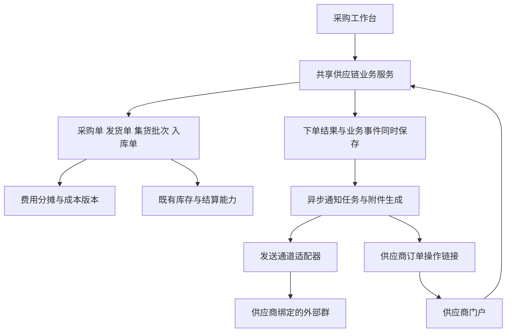
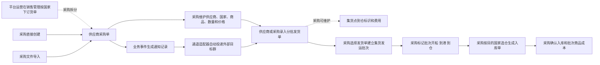

# 供应链协同模块建模架构建议

更新日期：2026年10月14日。

建议采用“内部协同工作台 + 供应商门户”两个入口。可选关联上游平台运营订货单，供应链模块维护采购单、发货单、集货批次和入库单四类核心单据；采购与供应商通过两个入口操作同一套采购及发货数据，运营订货单仅作为可选来源引用，不在本模块编辑或复制。各类单据维护本环节事实并通过明细来源关系连接；价格快照、费用及分摊结果、成本版本、结算记录和企微通知分别保存。

运营订货单在本协同系统的“销售管理”新增独立入口，由平台运营按国家、SKU和需求数量下单。它独立于平台同步的客户销售订单，支持新货手工订货，以及按周期或季节观察销量、库存和目标库销比生成建议后人工核对提交。采购从已提交运营需求拆单，也可以不关联运营需求而直接创建或导入采购单。供应链模块的操作角色仍只有采购和供应商。

本版按已确认的业务需求重新定义模型，供产品和开发落地。供应商通讯页面的详细字段、自动投递要求、异常处理和验收条件见[企微通讯页面功能设计](D:/Users/Administrator/Documents/saas协同系统/供应链协同企微通讯页面功能设计.md)。同一供应商外部群每天持续自动投递5条以上（验收同日至少6条）、无需群主逐条确认是硬需求；满足该要求的实际发送通道尚待选型和真实环境验证，当前设计不代表已实现。

应用消息、智能机器人及客户端自动化工具的适用范围和试用条件见[外部群自动投递工具评估与验证方案](D:/Users/Administrator/Documents/saas协同系统/外部群自动投递工具评估与验证方案.md)。其中 WorkTool 为待真机验证的候选，不代表现有企微自建应用已支持外部群自动投递。

已核查用户提供的 gy 后端代码：测试、重发及采购单通知均使用仅面向内部应用群聊的`appchat/send`，该发送链路不能用于含个人微信成员的供应商外部群。现有代码还未实现群通知总金额、Excel/PDF文件发送、群内供应商操作链接或通用转发入参。gy服务器及配置、文案和日志框架可作为改造通知转发服务的基础，但必须另接经过真实外部群验收的通道，并核验新通道的群绑定。跨系统转发独立标识来源系统、来源单据及版本；中间转发不改变上游接口权限，不要求复制完整采购单。完整证据见上述评估文件。

供业务人员讨论和验收的[业务需求说明](D:/Users/Administrator/Documents/saas协同系统/供应链协同业务需求说明.docx)另以角色、操作流程、页面内容、费用示例和验收场景表达同一套需求。

## 系统整体架构

建议在正式协同系统中采用模块化单体：采购工作台和供应商门户调用同一套供应链业务服务，复用既有商品明细和账号权限。国家及仓库复用现有档案；按已确认范围，入库确认先完成本系统收货流水，库存以第三方仓回传为准，不把本地入库量直接累加到第三方库存快照。费用分摊、成本版本和通知任务按职责独立建模；附件生成和消息投递由后台异步任务执行。首期无需把采购、发货、集货和入库拆成多个微服务。

| 层次 | 组成 | 主要职责 |
| --- | --- | --- |
| 操作入口 | 内部采购工作台、供应商门户 | 不同登录和数据权限；共用采购单与发货单数据 |
| 业务服务 | 采购、发货、集货、入库 | 校验来源关系、国家、数量和单据动作，保留操作记录 |
| 成本服务 | 价格快照、费用台账、计量依据、分摊、成本版本 | 独立于物流及付款状态，支持全链费用调整 |
| 协同服务 | 联系人账号、订单操作链接、附件版本、通知记录 | 供应商访问权限、Excel和PDF生成、事件及投递进度 |
| 通道接入 | 通知适配器、发送账号或设备、目标群映射 | 对接通过验收的自动投递工具；更换工具不改变业务单据 |
| 共享能力 | 商品明细、既有认证、国家仓库、库存及结算连接 | 复用已有档案，入库写本系统流水，库存读取第三方回传；不复制商品档案或增加模块操作角色 |

采购和供应商是本模块仅有的两个操作角色。应用配置、费用、物流状态和入库等内部动作由采购承担，可沿用现有系统的细分权限控制；不额外创建运营、仓管或财务角色。平台运营仍在上游操作运营订货单。

## 现有模块改造边界

新版在现有协同系统的供应链模块内重构，最终使用统一的新版入口和业务链路。六个开发阶段是同一模块内部的实施顺序，不是另外建设六套系统。

发布记录对应的父基线源码e63cd147显示，现有采购已通过真实接口关联商品SKU、供应商主数据、租户和用户权限，装箱、集货及发运也有持久模型；部分供货流页面仍允许Mock fallback，且遗留采购及供应商发货模型与较新链路并存。因此改造范围包含后台聚合、来源关系和页面连接，不能仅按独立页面替换处理。该结论依据2026年10月11日发布记录的源码基线，不代表2026年10月12日生产环境的实时验收。

| 处理方式 | 范围 |
| --- | --- |
| 复用 | 商品与供应商主数据、租户及员工账号、已有的授权隔离、审计和幂等基础能力 |
| 重构或替换 | 采购来源与多商品明细、共享供应商发货单、集货批次来源、批次物流三状态、按国家入库及对应页面和接口 |
| 新增或补齐 | 联系人门户、价格自动维护、三阶段费用分摊及成本版本、供应商群绑定、自动通知适配器和真实投递证据 |
| 保留历史 | 已有单据、装箱及发运记录、库存和结算来源；通过映射迁移或只读查询保留追溯，不直接删表清空 |

旧箱实体目前参与装箱、集货和发运分配。新版供应链按已确认规则只要求上传全部箱号附件，新的集货批次直接关联发货单，不能继续要求供应商逐箱录入。旧箱实体如仍被其他能力或历史记录引用，保留其数据和引用；新版业务入口不依赖旧逐箱录入流程。

实施从已核定的正式源码基线建立隔离开发版本，先给出旧新字段映射、接口及权限差异，完成数据迁移验证和整链验收后切换原模块入口。采购和供应商同时编辑、重复入库、费用改价、通知失败恢复均作为新版必过场景；不在带有其他未提交改动的工作区直接覆盖整套代码。

第一阶段后台基础已于2026年10月12日在独立分支`codex/supply-chain-phase1-20261012`完成本地开发，包含四类核心单据在内的13个持久模型、结构及权限迁移、事务服务、分角色只读API、能力契约和只读历史迁移预检。45个不同测试最终通过；两个测试准备问题经修正并复测，原始结果均保留。详见[第一阶段交付说明](D:/Users/Administrator/Documents/saas协同系统/.worktrees/supply-chain-phase1-20261012/saas-collab-system/docs/supply-chain/phase1/README.md)。正式系统未切换；真实上游来源核验、供应商页面、文件处理、库存写入、费用成本和外部群投递仍按后续阶段开发验收。

第二阶段于2026年10月13日完成本地开发与验收：采购工作台接入真实接口，支持手工和Excel导入采购、草稿改价与确认、备注单号、供应商及货运档案维护、采购保存自动报价与价格历史、三表采购Excel和SKU二维码标签PDF。后端75项与前端31项测试通过，实际浏览器建单、改价确认、导入、档案维护和文件下载已验证。菜单迁移保留已有入口授权，维护动作仍需单独授权；供应链业务日期默认北京时间，避免凌晨日期校验偏差。确认后的文件使用不可变快照，通知记录保持通道待验证状态。详见[第二阶段交付说明](D:/Users/Administrator/Documents/saas协同系统/.worktrees/supply-chain-phase1-20261012/saas-collab-system/docs/supply-chain/phase2/README.md)。本阶段未发布到正式系统；供应商门户、发货与集货入库页面、费用成本、自动外部群通道及目标MySQL迁移并发验收仍在后续范围内。

第三阶段于2026年10月13日完成本地开发与验收：供应商独立登录和订单链接返回、采购维护多个供应商联系人、供应商分批发货及采购代录、超采购数量和新增SKU、上传全部箱号信息附件、采购调价和集货到仓标识。采购及供应商使用同一张发货单，供应商不能修改内部价格；私有附件下载重新校验授权和完整性。后端102项、前端51项测试通过，并完成真实浏览器操作和文件下载哈希核对。详见[第三阶段交付说明](D:/Users/Administrator/Documents/saas协同系统/开发交付/供应链协同第三阶段_20261013/README.md)。尚未发布到正式系统；集货批次物流及入库页面在第四阶段，费用成本在第五阶段，高频自动外部群投递仍待后续真实验证。

第四阶段于2026年10月13日完成本地开发与验收：已到和未到集货仓的发货单均可组批，按批次维护开船、到港、到仓并自动在采购及供应商发货单展示；目的仓到仓后选择国家对应仓库生成入库草稿，逐来源行核对实收及差异，确认后写入不可变内部收货流水。后端113项、前端58项通过，实际浏览器验证应收28件、实收27件及四条来源记录。现有第三方仓接口仅可读取，未写入或伪造外部库存快照；总体可用库存余额与外部WMS写接口仍未实现。详见[第四阶段交付说明](D:/Users/Administrator/Documents/saas协同系统/开发交付/供应链协同第四阶段_20261013/README.md)。尚未发布到正式系统；第五阶段为费用和成本，高频自动外部群投递仍待验证。

前四阶段完善于2026年10月14日完成本地验收：销售管理新增按国家的运营订货单，支持新货手工订货及周期/季节库销比预览、人工核对和提交，采购按剩余需求拆单；取消采购草稿释放需求，运营来源仍可调价。未开船批次支持成员调整和取消，已记录物流日期可带原因更正且自动带给发货单。后端155项、前端82项通过，实际页面验证建议15件核对为14件、需求10件有效采购6件剩余4件；更正物流日期后原27件入库流水保持不变。入库先完成本系统收货流水，库存以第三方仓回传为准，按已确认范围不要求本期写入外部库存。详见[前四阶段完善交付说明](D:/Users/Administrator/Documents/saas协同系统/开发交付/供应链协同前四阶段完善_20261013/README.md)。尚未发布到正式系统；费用成本和高频自动外部群投递仍在第五、六阶段。

## 业务主干和数量口径

本模块只有采购和供应商两个操作角色。内部采购工作台仅供采购登录和操作；供应商门户使用独立登录和权限，只展示所属供应商的采购单、发货单及附件。平台运营在同一协同系统的销售管理操作运营订货单，该单据可作为采购来源，运营人员不属于供应链模块操作角色。采购代录与供应商自行录入共用同一张发货单。

| 职责范围 | 承担内容 |
| --- | --- |
| 订单与发货 | 运营来源可选；采购可拆单、直接创建或导入；分批发货、超单识别和来源数量追溯 |
| 集货与入库 | 选择发货单组批、批次物流三状态、按国家选仓和实际入库 |
| 价格与成本 | 价格快照、费用调整、按体积及重量分摊、成本版本和结算差额 |
| 供应商协同 | 独立账号、订单填写链接、箱号附件和采购代录 |
| 外部群自动投递 | 业务事件通知、供应商目标群绑定、发送账号或设备、附件版本、投递证据及异常恢复 |

集货可以选择已标记集货点到仓或未标记到仓的发货单，不能以到仓标识为强制筛选条件。图中的到仓维护是可在发货单上进行的操作，不是集货必须完成的前置收货步骤；不建立集货收货单。

平台运营订货数量、采购数量、供应商实际发货数量和实际入库数量分别记录。采购单可关联运营来源，也可无来源直接创建或导入；无来源时不虚造运营单或回写运营进度。超采购数量、新增商品和入库差异有明确标识，不自动改写上游计划。

## 核心单据及来源关系

| 模型 | 主表关键字段 | 明细和关系 |
| --- | --- | --- |
| 运营订货单（销售管理） | 单号、国家、平台运营人员、日期、新货/周期/季节来源、业务状态、备注、计算依据快照 | 引用现有商品，记录需求、已分配和剩余数量；一条订货明细可拆给多个供应商采购明细 |
| 供应商采购单 | 系统单号、可选备注单号、供应商、国家、创建方式、采购人员、日期、总数量、总金额 | 商品、采购数量、资料参考价、供应商参考价、本次有效采购价；可选通过来源分配明细关联运营订货明细 |
| 供应商发货单 | 发货单号、供应商、国家、来源采购单、本次发货批次、发货日期、集货点到仓标识、备注 | 商品、实际发货数量、采购价快照、有效发货单价、来源采购明细及超单类型；箱号信息附件 |
| 集货发运批次 | 批次号、目的国家、货运公司、货运单号、唛头快照、物流阶段、各阶段实际日期、计费方数、备注 | 关联多张发货单；保存批次费用和物流事件 |
| 入库单 | 单号、来源集货批次、国家、目标仓库、入库日期、业务状态、清货费用和方数 | 对应来源发货明细、应收数量、实收数量、差异备注及成本引用 |

首期一张采购单对应一个供应商和一个国家，可由采购拆分运营来源、直接创建或通过文件导入。运营来源关联和来源分配明细均为可选；存在来源时保存原订货明细、采购明细和分配数量，无来源时不创建虚假运营单。采购单记录创建方式。直接创建可手填备注单号，导入可映射备注单号列；备注单号独立可选、允许重复且可修改，不替代系统唯一单号，也不作为唯一键或去重依据。导入保留文件、导入批次和行定位，提供模板、字段预览、逐行校验错误与导入结果；供应商、国家、商品和数量必填，价格可按价格档案带入或待采购补齐确认，未完善的价格不写入有效价格档案，也不允许据此发送通知。同一导入任务重复提交不得重复建单。

运营需求提交后冻结内容。采购可部分拆单，分配数量不得超过剩余需求；取消尚未下单的采购草稿会释放对应需求，并保留历史分配及变更记录。运营来源采购草稿允许调价、改日期和备注，但国家、供应商、商品和分配数量不能直接改写，需取消草稿后重新拆分。通过角色权限页面按“站点/国家”控制运营需求范围，采购拆单另检查供应商授权；不从供应商授权反推尚未分配的运营需求可见范围。

库销比建议使用授权国家内店铺本地日期的有效已付款销售订单，以及第三方仓最新库存事实，保留周期、目标比例、是否计入在途、来源及生成时间。观察口径为期间创建且在期间结束前已付款的订单，退款尚未扣除，采集覆盖仍需业务复核；缺少销量或库存、存在未映射来源或来源失败时不给出建议数量，不能把缺失当成零库存。有效建议经运营核对后保存为周期或季节需求，不直接自动下采购单。

首期一张供应商发货单关联一张采购单，一张采购单可以分多次发货。新增发货 SKU 从现有商品明细中选择，来源采购明细可以为空，但须保存新增商品标识及来源采购单。超数量发货保存超量数，不因超单自动阻止录入。采购人员可代供应商录入同一模型，记录录入人及录入方式。

首期整张发货单进入一个有效集货批次，不做发货单内部拆批。同一批次仅包含同一目的国家的发货单，可以跨供应商、跨采购单集货。同一发货单不能同时参加两个有效发运批次。未开船前可以调整集货选择，开船后更正必须保留变更记录并处理费用及成本影响。

批次到目的仓后，采购发起“生成入库单”并选择目标仓库，系统按整批来源明细生成入库草稿。选仓列表按批次国家过滤，只能选择该国家有效仓库；仅标记物流到仓不会自动建入库单或增加库存。采购核对实际数量并确认入库后，生成本系统不可变收货流水，第三方仓库存仍以其回传为准。可在页面按SKU汇总应收数量，但后台保留每条发货来源，以支持不同采购价和费用归属。重复生成或重复确认不得重复创建入库记录或收货流水；若以后扩展分批入库，须按来源明细剩余可入库数量生成。

## 两种到仓和物流状态

供应商发货单维护的是集货点到仓标识，可附标记时间和操作人。这一标识不建立独立收货单，也不代表目的国家仓库已入库。

集货批次维护开船、到港、到仓三个物流阶段。未标记只是初始值，不增加新的物流环节。状态及日期由采购在批次上标记，系统自动带给该批次下所有发货单。发货单页面仅展示批次物流状态，不提供单独修改这三个状态的按钮。

每次标记、补录或更正记录操作人、实际发生日期和操作时间。物流到仓与入库完成分别保存，批次到仓不会直接增加库存。本期不扩展装柜作业、倒仓任务、中转分拨或完整清货作业模块；入库保留必要实收数量、差异备注和清货费用字段。

## 商品资料和基础档案

商品明细是商品名称、SKU、规格、采购参考价、单位体积和单位重量的唯一资料来源。各业务明细引用商品 ID，并保存需要追溯的快照，不再增加重复的商品 SKU 档案菜单。供应商商品价格档案只维护供应商与商品的价格关系，不复制一套商品资料。

| 档案 | 主要字段和规则 |
| --- | --- |
| 供应商档案 | 名称、编码、联系人及联系方式、省份城市、工厂地址、装柜地址、税费点数、备注、启用状态；企微通讯页签维护默认通知群 |
| 供应商商品价格档案 | 供应商、商品引用、当前有效采购价、生效时间、来源、来源采购单、维护人、备注和历史价格；支持人工选择商品新增 |
| 货运公司档案 | 名称、联系人及联系方式、省份城市、地址、唛头信息、每方费用、税费点数、备注、启用状态 |
| 国家和仓库对应关系 | 复用现有国家数据；仓库编码、名称、所属国家、地址、联系人、第三方仓标识和启用状态 |
| 外部群投递配置 | 供应商目标群绑定、发送账号或设备、通道适配器及状态；凭据由服务端保护，供应商业务登录身份独立维护 |

创建采购单并完成有效价格保存后，自动按供应商和商品新增或更新供应商商品价格档案，记录来源采购单和价格历史。按价格生效时间和版本确定最近有效价，旧单的旧生效价格不覆盖更新的有效价格。未填完整、无效或作废的价格不发布为最近有效价。供应商发货单的临时调价默认仅影响该次发货；如需改长期价格，采购明确执行同步价格档案操作。

货运公司每方费用、唛头和税费点数在业务单据中带出并保存快照，实际费用仍可调整。税费点数是本次计价参考，单价和费用需明确包含口径，避免在已含税金额上再次重复计入同一税费。

不新增成本分摊规则档案、单位档案、币种档案或汇率档案菜单。分摊方法及比例放在具体费用维护页面；数量、体积、重量单位和金额口径固定在字段或复用现有系统配置。

## 三阶段价格和价格档案更新

| 阶段 | 价格处理 |
| --- | --- |
| 下供应商采购单 | 同时展示商品资料采购价和供应商最近有效价；默认取供应商有效价，无有效价时取商品资料价，采购可以修改 |
| 保存采购单 | 保存本次采购单价及来源快照，自动完善供应商商品价格档案；后续修改保留版本 |
| 供应商实际发货 | 发货行继承来源采购价；采购可再次调整，调整后的发货单价作为该发货数量的有效货值单价 |

采购价快照与发货单价不相加。只有实际发货数量进入发货成本单元；未发数量留在采购待发口径。新增商品和超采购数量均按自己的有效发货单价进入货值，不能因为不在原采购明细中而遗漏成本。

新增 SKU 无来源采购明细时，系统带出商品参考价和供应商最近有效价，由采购确认本次发货单价。发货单调价不反向改写采购单历史价。

已入库后发生有效发货价调整，保留原单据及成本版本，通过成本差额反映变化，不重新增加库存数量，也不自动修改商品资料中的采购参考价。

## 费用台账和分摊模型

费用以独立记录保存所属单据、费用类型、金额、是否暂估或已确认、业务说明、分摊方法、分摊比例、相关数量及计量快照、维护人和版本。单据页面维护费用，费用台账提供统一查询；商品货值由有效发货单价计算，不再作为另一笔重复采购费用录入。

| 费用来源 | 维护时点和范围 |
| --- | --- |
| 发货单集货点到仓费用 | 标记集货点到仓时可维护；分给该发货单有效商品明细 |
| 集货批次货运费用 | 开船后维护实际运费和方数；分给该批次关联的发货明细 |
| 入库单清货费用 | 入库单预留费用及方数；启用后分给该入库单实际归属商品明细 |

维护方数时区分批次计费总方数与商品分摊体积。计费总方数用于费用核对及每方费用计算；商品份额用商品实际体积，未取得实际体积时用数量乘商品单位体积并注明估算。整体计费方数不平均复制到每条商品明细。

每项费用可以选择按体积、按重量或体积重量混合，并可修改混合比例。默认混合比例为体积 50%、重量 50%，采购可以在本项费用中调整；比例合计必须为 100%。

设商品 i 的分摊体积为 V_i，分摊重量为 W_i，体积比例为 α：

`商品分摊比例 = α × V_i / ΣV + (1 − α) × W_i / ΣW`

`商品分摊金额 = 本项费用金额 × 商品分摊比例`

数量、体积和重量取当前分摊范围的有效业务明细，不取运营计划量或未发采购量。公式中比例为零的维度无需参与校验；有正比例的维度缺少商品数据或总量为零时提示补全，不能静默改用另一分摊方式。暂估结果注明计量依据，缺失必要依据时不确认成本。

分摊金额按系统金额精度处理，尾差按固定顺序归属，例如按未舍入小数余数排序、同值按明细 ID 排序。每项费用有效分摊额合计必须等于原费用金额。金额、计量依据或比例变化产生新版本，新结果替换旧有效结果，不能累加两版费用。

## 最终商品成本和结算

成本以发货商品明细形成成本单元，并保留国家、后续仓库和入库来源。商品页面可以按 SKU、国家、仓库和批次查询成本，不能把不同批次、不同国家的成本简单覆盖为一个无来源的全局价格。

`批次商品单位成本 =（该商品有效货值 + 已归属的各阶段费用）/ 该成本口径对应数量`

发货阶段按有效发货数量计算暂估单位成本。入库阶段按对应来源明细的实收数量释放货值和已归属费用；未入库或待核对数量对应成本保留在待入库或差异口径，不因少收而自动全部压给已入库商品。若部分入库，不对剩余数量重新分摊一遍原费用。

入库单清货费用仅归属该次入库的实收商品，不回摊到未入库数量。

| 状态维度 | 含义 |
| --- | --- |
| 费用状态 | 未维护、暂估、已确认；未维护不自动解释为费用为零，确认无费用时明确记录零金额 |
| 成本状态 | 暂估、已确认、待复算；必要费用及计量未确认时不能显示最终成本已确认 |
| 结算状态 | 未结算、部分结算、已结算；与费用和成本状态分别维护 |

商品支持供应商及货运结算前后计算或调整成本。必要价格和费用已经确认时，即使尚未结算，也可形成已确认成本；仍有待确认费用时显示暂估成本，即使供应商或货运已经结算也不例外。结算、付款及成本确认是独立状态，不能以已付款替代费用确认。

供应商结算关联双方确认的发货货值，货运结算关联已确认货运费用；对账和付款复用现有财务能力。结算明细引用来源单据和金额版本，不用采购计划金额替代实际确认货值。后续调价或改费用可以产生新的待对账差额，原付款记录保留。

采购价、有效发货价、到仓费用、货运费用、清货费用、方数和分摊比例均可在权限范围内调整。未入库部分更新有效成本版本；已入库部分形成金额差额调整，库存数量不变。已有出库业务的差额交现有库存或财务口径处理，不在本模块重新生成出入库数量。

## 供应商协同和企业微信通知

外部群通知是由业务事件驱动的自动投递链路。供应商档案绑定目标外部群；采购页面按群名和发送账号显示名选择，系统分别保存平台官方`chat_id`（可取得时）与所选通道的目标类型和目标值。通道目标可以是群名称、群备注或工具自身提供的标识，不统一假设为官方群ID。同名群必须展示可核对资料并防止误发。发送账号或设备必须是目标群成员，但不要求是群主；供应商门户登录身份与外部群发送身份独立。

供应商档案的“通讯设置”提供“选择通道—选择发送账号或设备—选择目标群—核对群资料—保存绑定”的操作。官方群及成员数据可用时由系统读取群名、群主、成员数和成员显示名，技术ID在后台保存；通道采用客户端群名称定位时，另保存经核验的群名称或群备注。不能拉取的通道提供受控登记及人工核验入口，不要求普通采购从代码或接口返回值中复制ID。群主信息用于核对目标群，不再作为逐条确认发送的负责人配置。

WorkTool当前发送消息接口使用`titleList`填写好友或群名称，并不直接接收企业微信官方外部群`chat_id`。因此后台的供应商群绑定应保存官方群标识（可取得时）、通道目标类型、通道目标值和核验状态；WorkTool适配器把已核验的通道目标值转换成该工具的参数。同名或无法唯一定位的群不能直接标为可投递。该映射规则依据[WorkTool发送消息文档](https://worktool.apifox.cn/api-23520034)，不是把官方`chat_id`当作群名称使用。

新采购单通知以采购完成下单且订单保存成功为触发点，自动读取该供应商绑定的现有外部客户群及通道目标映射，准备采购单摘要、Excel、PDF 和供应商操作链接，再交发送通道投递到该群。运营拆单、直接创建或导入的采购单均在确认下单成功后触发；草稿保存、导入预览、价格未补齐、下单失败及单纯通知预览均不触发。采购无需单独点击发送，群主无需逐条确认。

采购单确认下单结果与下单成功事件在同一事务内保存，通知任务在事务成功后异步处理。以订单ID、单据版本和通知类型防止重复通知。缺少群绑定、附件生成失败或发送通道不可用时，采购单保留成功下单结果，通知任务保留具体原因并提供恢复入口；重复提交下单动作或查看预览不能重复投递。官方`chat_id`仅承担官方群识别和来源核验，实际调用参数由已核验的通道目标映射生成，发送能力仍须通过真实外部群验收。

通知模型至少保存业务事件、通知记录、通道适配器、发送账号或设备、供应商目标群绑定、订单及附件版本、每次投递尝试日志和真实投递证据。通知预览包含系统采购单号、备注单号（有值时）、来源方式、国家、总数量、总金额、采购发货 Excel、SKU 标签 PDF 和有权限的实际订单操作链接。Excel 含系统采购单号及有值的备注单号、采购订单、发货批次数量填写页、批次发货箱号信息填写页；PDF 含 SKU 二维码、SKU 文本和商品名称。附件按订单版本保存。

业务附件由系统持久保存并控制供应商访问权限；通道所需媒体仅作为投递材料。服务受理、任务创建成功或客户端界面点击均不能证明送达。只有能关联目标群、消息及发送时间的真实投递证据才记为已投递；外部成员实际打开并保存附件、访问操作链接另行验收。

硬性需求是同一个供应商外部群每天持续自动投递5条以上业务消息，验收同日至少6条且无需群主逐条确认。原客户群群发流程不属于方案、备用通道或验收功能。历史`add_msg_template`的频率失败仅说明原路径不满足需求，不能证明任何替代自动通道有效。可评估客户端RPA或可核查实际发送机制的服务，但均须通过真实外部群验收；目前没有已核实满足要求的官方直发API。

WorkTool作为客户端自动化候选，由后台适配器调用工具API，再由在线安卓设备上的企业微信账号实际发到目标群。文本接口和文件接口已有公开文档，其中文件下载发生在安卓端，设备必须能读取受控文件链接；普通可点击网址可以随文本发送，不能未经验证就宣称链接卡片功能可用。依据[文本接口](https://worktool.apifox.cn/api-23520034)和[文件接口](https://worktool.apifox.cn/api-43191166)进行实现，接口请求限速与同一外部群的实际可用频率分别验收。已完成测试环境安装和测试附件准备，真实群文本、Excel、PDF和链接投递尚未通过验收；供应商填写页面也不能用首页访问结果替代。

一张采购单的摘要、Excel和PDF作为一个通知包管理，每个实际发送部分有独立进度。附件URL仅授予读取对应文件的权限并设置合理有效期，订单操作链接仍要求供应商身份校验；工具凭据及发送账号不会嵌入供应商链接。文字成功而PDF失败时保留部分完成状态，核验后只恢复未完成部分，不重发整个通知包。

若候选方案为客户端 RPA，需记录实际发送账号或设备、客户端在线状态和任务状态。掉线进入待处理；同名群需再次核验；结果未知时先查询或人工核对原消息以防重复；消息按单据及版本幂等；恢复后不得错发或重发已成功消息。

供应商在受控订单链接中操作发货单，采购可在后台代录，二者使用同一数据模型。发货批次录入与所有箱号信息附件上传是两个操作区；箱号内容只上传附件，不增加强制结构化装箱填写流程。自动投递发送端身份与供应商业务身份分别处理。

Excel 中的箱号信息填写页是线下附件模板，供应商填写后可作为箱号信息附件上传；系统网页不要求逐箱重复填写。

系统入口采用 https://xtsy.dingfengchuangyu.com/ 。供应商填写链接需指向有对应订单权限的页面，不能用首页替代。供应商网页填写、保存及附件回传尚待开发验收；当前首页可访问不等于这些功能已可用。

## 供应商门户和内部登录

内部协同系统与供应商门户使用不同的登录页面、身份及菜单，后台复用同一套采购单和发货单数据。内部入口仅供采购操作；供应商入口面向供应商联系人，适配手机及企微内打开。

| 项目 | 内部协同系统 | 供应商门户 |
| --- | --- | --- |
| 登录入口 | 沿用现有员工登录入口 | 建议入口为 https://xtsy.dingfengchuangyu.com/supplier/login ，该路径为待开发设计 |
| 登录身份 | 员工账号（采购身份） | 供应商联系人账号，绑定有效供应商档案；不要求联系人属于本企业企微通讯录 |
| 主要页面 | 采购单、发货单、集货批次、入库、费用、成本、档案和通知 | 待发采购单、我的发货单、附件下载及账号信息 |
| 数据范围 | 采购可访问本模块业务数据 | 仅本账号所属供应商的已发布订单、发货单和附件 |
| 可操作内容 | 采购调价、代录、集货、物流标记、费用、成本、档案和入库 | 按订单录入发货批次、数量及可选追加商品，上传全部箱号信息附件 |
| 不开放给供应商的内容 | 由采购权限控制 | 其他供应商数据、货运及清货费用、最终成本、内部价格档案、批次整体商品明细和内部管理菜单 |

供应商可查看本供应商订单的采购数量和对外价格，不能修改采购或发货有效单价。集货点到仓标识、批次物流状态和费用均由采购维护；供应商可查看自身发货单继承的物流状态，不因参与同一集货批次而看到其他供应商商品。

首期采用供应商独立账号登录，由采购在供应商档案的联系人账号区创建、绑定、启用或停用。一个供应商可有多个联系人账号，操作记录保留具体账号。账号名称和身份管理复用系统能力，短信快捷登录及外部身份授权另行选型，不预设自建应用的员工授权即可登录外部供应商。

已补充核查gy的`wechat-oauth`：它使用微信服务号网页授权，可作为微信快捷登录的改造基础，但当前把微信身份写在供应商主档、登录取首条联系人profile，不能可靠区分多个联系人。采用此能力前，应将微信身份绑定到具体联系人账号，补齐一次性绑定授权、账号有效性和订单归属校验，并由xtsy自己的认证体系建立会话；不得仅修改跳转域名就沿用另一认证项目的登录票据。该能力不改变外部群消息投递方式，也不表示供应商填写页面已经完成。[OAuth核查说明](D:/Users/Administrator/Documents/saas协同系统/wechat-oauth源码核查说明.md)

企微订单链接包含可验证的目标订单定位信息。未登录时进入供应商登录页，登录成功后校验供应商与订单关系，并返回目标订单；已经登录则校验后直接打开。账号无权限、链接失效或订单不可访问时提供明确处理提示。即使链接被转发，接收者也不会因此取得该供应商权限。

外部群发送账号或设备与供应商业务身份分别维护。采购代录进入内部系统，供应商自录进入门户，最终保存到同一发货单模型，避免两套数据再次同步。

权限校验覆盖每次订单读取、附件下载和发货单保存，由后台依据身份及供应商归属执行，页面菜单与按钮按同样权限展示。[访问权限设计依据](https://cheatsheetseries.owasp.org/cheatsheets/Authorization_Cheat_Sheet.html)

## 页面组成和操作体验

| 页面 | 必须具备的主要行为 |
| --- | --- |
| 销售管理运营订货单 | 平台运营按国家、商品和数量下单，或预览库销比建议并人工核对；显示已分配及剩余需求，采购菜单提供拆分，不编辑运营需求 |
| 供应商采购单 | 运营来源可选；支持运营拆单、直接创建和文件导入；列表及详情展示系统单号和有值的备注单号，后者可重复，维护供应商、国家、商品、数量及价格，生成总数量总金额、附件版本和业务事件 |
| 采购单导入 | 下载模板、预览字段、校验必填项和价格、查看逐行错误及导入结果，重复任务不重复建单 |
| 供应商发货单 | 分批发货、超数量及新增 SKU、采购代录、有效单价调整、全部箱号信息附件、集货点到仓标识及费用 |
| 集货发运批次 | 显示所有可集货发货单并可按集货点到仓筛选、选择货运公司和货运单号、维护方数和运费、批次三状态标记 |
| 入库单 | 批次到仓后生成、按国家选择仓库、来源数量核对、实收入库、防重复生成、清货费用和方数预留 |
| 成本查询与调整 | 按 SKU 国家仓库批次查询货值和分项费用、显示暂估及确认状态、修改费用和分摊比例、查看版本和差额 |
| 费用及结算查询 | 查询各阶段费用、对账来源、结算进度和调整差额，对接现有财务 |
| 基础档案 | 供应商、供应商商品价格、货运公司、仓库及国家关系，商品资料复用商品明细 |
| 自动投递记录 | 查看业务事件、目标群、发送账号或设备、通道、附件版本、各次尝试及真实投递证据 |
| 供应商通讯设置 | 按名称选择通道、发送账号或设备及目标群，核对成员资料；系统维护官方群标识和通道目标映射，保存及连通性检查不发送业务消息 |
| 供应商门户 | 独立登录及订单定位，查看本供应商订单、下载附件、填写发货批次、上传箱号信息 |

字段说明使用业务名称。技术 ID、应用凭据由后端保护；采购维护应用配置并查看只读诊断，Secret 不回显，普通采购无需抄写技术 ID。

## 后台模型及开发验收

| 模型组 | 建议保存的独立实体 |
| --- | --- |
| 商品及关系档案 | 复用商品明细、供应商、供应商商品价格及价格历史、货运公司、国家仓库关系 |
| 订单主干 | 销售管理拥有运营订货主明细和建议快照；供应链引用其明细，维护采购主明细（创建方式、可选备注单号）、可选运营采购来源分配、导入文件/批次/行定位、发货主明细及附件 |
| 物流及入库 | 集货批次、批次发货单关联、批次物流事件、入库主明细及来源关联 |
| 费用与成本 | 费用、费用版本、分摊结果、成本单元及版本、入库成本差额调整 |
| 财务关联 | 应付及对账来源、结算引用及调整差额，复用已有付款记录 |
| 通知与供应商身份 | 业务事件、通知包及各发送部分、通道适配器、发送账号或设备、供应商目标群绑定、可选官方chat_id及通道目标类型和值、附件版本、尝试日志、真实投递证据、供应商联系人账号与供应商关系 |

每笔分摊必须追溯到一个有效费用版本，每笔商品货值必须追溯到一个有效发货明细价格版本，每条入库明细必须追溯到来源发货明细。业务状态、物流状态、成本状态、结算状态和投递状态分别保存。

首期范围采用每张采购单一个供应商和一个国家、每张发货单对应一张采购单、整张发货单加入一个有效集货批次、整批按一个目标仓库生成入库单。这些是简化实现的建模建议；以后需要跨采购单发货、发货单拆批或一批分仓时，应扩展来源分配关系，而非覆盖已有数量和成本记录。

导入提交、确认下单、加入集货及确认入库需要数据库事务和幂等控制；更新单据时校验版本，防止采购与供应商同时编辑互相覆盖。业务记录统一保留所属企业、操作者、创建及更新时间、有效状态和版本。已发生下游业务的单据采用留痕更正或冲销，不直接删除来源记录。

推荐的有效性约束包括：同一发货单只能关联一个有效集货批次；入库数量不得因重复确认累加；有效费用版本的分摊总额等于费用金额；同一采购单版本和通知类型只有一个通知包。对超采购商品和数量建立异常标识，不把“不得超采购量”写成发货明细的数据库约束。

验收包含正常链路及以下必要边界：

1. 运营来源采购单按供应商拆分后可追溯数量；无来源的采购单可直接创建并完整跑通后续链路，采购来源可选，跨国家不会混到同一采购或集货批次。
2. 采购单文件导入按合法字段成功并提示异常行；重复提交同一导入任务不重复建单，备注单号可选、可修改、可重复且不影响系统单号唯一性。
3. 一次采购多次发货，超数量和新增商品均可录入且进入货值与费用分摊，不重复累计采购价。
4. 采购代录与供应商录入保存同一发货单，全部箱号信息附件可访问并追溯版本。
5. 已标记或未标记集货点到仓的发货单均可集货，同一发货单不会重复发运。
6. 物流三状态只在批次标记，发货单自动继承；目的仓到仓与库存入库分开。
7. 入库按国家选择仓库，重复生成和确认不重复记收货流水，同 SKU 多来源数量可追溯；库存以第三方仓回传为准，成本按第五阶段口径验收。
8. 混合比例可修改；有效分摊额之和等于费用金额，缺少所需计量不会产生虚假确认成本。
9. 结算前后都能计算成本，全链费用改动只更新有效版本；已入库调整只产生金额差额。
10. 非开发人员可按群名和发送账号显示名完成目标群绑定，账号成员关系变化或授权失效有处理提示，保存和检查不发送消息。
11. 通知显示总数量、总金额、Excel、PDF 及实际订单操作链接；服务受理、界面点击不充当送达证据。
12. 验证同一个含外部微信成员的真实群同日自动投递不少于 6 条且无需逐条人工确认；含 Excel、PDF 和操作链接，外部成员实际打开并保存附件。
13. 验证次日重复投递、发送端掉线与恢复；结果未知先核对，重试幂等，且不重复、不误发。自动投递实际机制和真实群验收未完成前，不得宣称已实现。
14. 供应商订单链接在未登录时进入独立登录页，登录后回到原订单；无权账号不能访问该订单、下载附件或写入发货单。
15. 供应商仅见自身订单与发货单，不能修改内部价格费用，也不能通过批次查看其他供应商商品；采购代录仍使用同一发货数据。
16. 标记批次到仓后，采购未选仓或未发起生成时不自动建立入库单；入库草稿未确认时不记收货流水，确认后也不直接改写第三方库存快照。
17. 上游运营订货单只读引用，本模块采购及供应商页面不能新建或修改运营订货单。
18. 已确认全部必要价格和费用但尚未结算时，可确认成本；已结算但有未确认费用时，成本仍显示暂估。
19. 一个通知包部分发送失败时，恢复操作只处理经过核验的未完成部分；WorkTool通道不会将官方chat_id直接传入群名称参数。

持续自动投递的稳定性验证建议以同一真实外部群连续7天、每日不少于6条作为上线验证口径，每条保留群内可见证据；这是建议的验证周期，业务硬需求仍是每天持续5条以上且无需逐条人工确认。验证应覆盖Excel、PDF、实际订单链接以及一次设备掉线后的有序恢复，不能只统计API返回成功。

开发顺序为：第一阶段完成数据、权限与事务基础；第二阶段完成采购工作台、基础档案和价格快照；第三阶段完成供应商入口、联系人账号、分批发货、采购代录和箱号附件；第四阶段完成集货与入库；第五阶段完成费用分摊及成本版本；第六阶段联调自动投递适配器。只有通过真实群高频投递验收，才能将通道标为可用。
